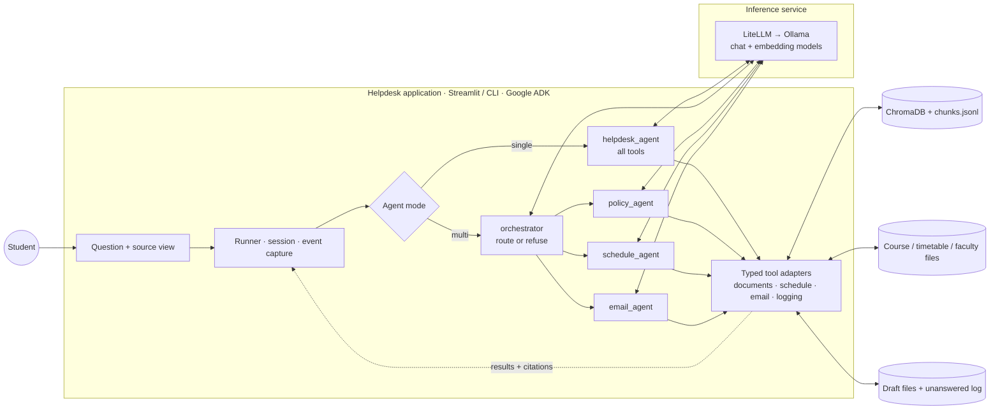
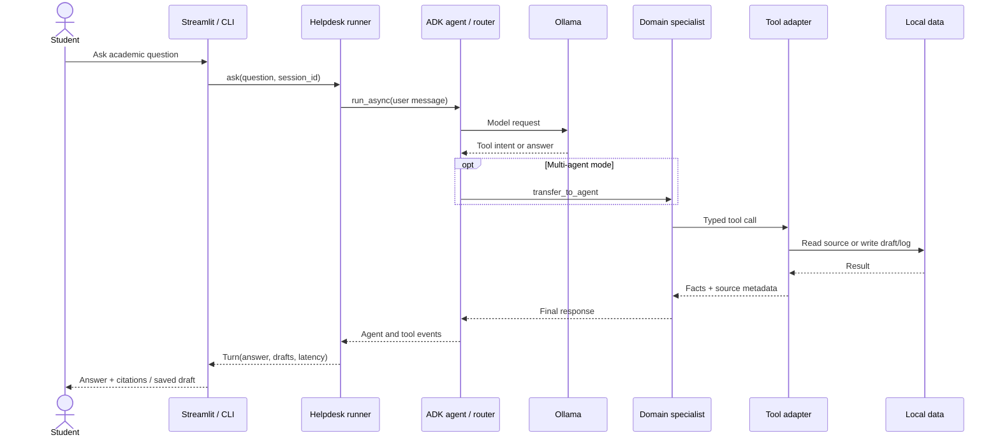

# IIT Jodhpur Academic Helpdesk

## Design, implementation and evaluation report

A multi-agent academic helpdesk built with Google ADK, Ollama-hosted 8B models and a ChromaDB RAG pipeline.
It was evaluated on 30 questions × 3 models × {single agent, multi-agent} × 3 runs, plus one ablation,
for **630 graded answers** in total.

**Project team:** Mohit Meemraauth (B23CS1038), Nisarg Upadhyay (B23CS1075), Divyansh Maheshwari (B23CM1015),
Tejas Kalkar (B23CM1051)

## Executive summary

This project builds a bounded academic helpdesk for IIT Jodhpur. It answers policy and timetable questions from institutional sources, looks up structured course and faculty data, drafts (but never sends) instructor emails, and refuses unsupported requests. Its retrieval pipeline combines dense search with BM25; its multi-agent configuration routes requests to policy, schedule and email specialists.

Across 630 graded responses, Qwen3:8b performed best. Single-agent mode reached 80.6% in-scope accuracy with 10.9-second mean latency. Multi-agent mode reached 79.9% accuracy, 94% groundedness and 96.7% routing accuracy, with 30.0-second mean latency. Both configurations correctly refused and logged all out-of-scope questions. The main deployment trade-off is therefore response time versus specialist modularity and stronger citation performance.

The report's visual architecture and evaluation figures are in the [PDF report](report.pdf). The diagrams below summarize the two primary system flows.





```mermaid
flowchart TB
  subgraph BUILD[Offline index build]
    DOCS[24 PDFs + 5 web pages] --> EXTRACT[PyMuPDF + OCR<br/>retain page numbers]
    EXTRACT --> CHUNK[Section-aware chunks<br/>350 words · 60 overlap]
    CHUNK --> EMBED[Ollama · nomic-embed-text]
    EMBED --> VEC[(ChromaDB cosine index)]
    CHUNK --> META[chunks.jsonl<br/>text + page metadata]
    META --> BMIDX[(BM25Okapi index)]
  end
  Q[search_documents(query)] --> DENSE[Embed query<br/>Chroma top 20]
  Q --> LEX[Tokenize query<br/>BM25 top 20]
  VEC -. indexed vectors .-> DENSE
  BMIDX -. lexical index .-> LEX
  DENSE --> RRF[RRF · k = 60<br/>rank fusion + top 5]
  LEX --> RRF
  RRF --> G{Best dense similarity<br/>< 0.65?}
  G -->|No| PASS[Evidence passages<br/>source + page citations]
  G -->|Yes| MISS[No relevant documents<br/>agent refuses + logs]
```

## 1. System

| Component | Implementation |
| --- | --- |
| Corpus | 29 public IITJ documents: 24 PDFs (four of them OCR'd scans) and 5 web pages, covering regulations, attendance/examination circulars, the 2026-27 academic calendar, holidays, fees, scholarships, forms, B.Tech./M.Tech. curricula and humanities courses |
| Structured data | Course offerings for Semester I 2026-27, the official slot system, the faculty directory, and the student's six registered courses (`data/structured/`) |
| RAG | Section-aware chunks of about 350 words with page ranges; `nomic-embed-text` embeddings in ChromaDB, plus BM25, fused with reciprocal rank fusion. Retrieval check before any agent existed: **hit@5 = 100 %, MRR = 0.96** (25 questions) |
| Tools | `search_documents`, `find_course`, `list_courses`, `get_slot_timetable`, `get_my_schedule`, `get_instructor_contact`, `draft_email` (saves only, never sends), `log_unanswered` |
| Single agent | One `LlmAgent` with all tools |
| Multi-agent | `helpdesk_orchestrator` hands each message to `policy_agent`, `schedule_agent` or `email_agent` via `transfer_to_agent`. Out-of-scope questions are refused by the orchestrator |
| Safety nets | An `after_agent_callback` logs any refusal the model did not log itself. `draft_email` rejects addresses that are not in the faculty directory. Drafts are shown verbatim from the tool output |
| Models | `qwen3:8b` (thinking off; the multi-agent orchestrator has thinking on), `llama3.1:8b`, `granite3.3:8b`. All run on Ollama 0.40.11 on a V100 |

## 2. Evaluation setup

- **Questions** (`eval/questions.jsonl`): 30 in total.
  - 12 policy, including two where the documents conflict: P01 attendance and P05 Major-exam duration, where the July 2024 circulars supersede the 2019/2022 regulations.
  - 8 schedule, including counting questions and "my classes".
  - 4 email or instructor-contact.
  - 6 out of scope, including two near-misses: "attendance requirement for the hostel mess" and "current Director of IIT Jodhpur".
- **Configurations:** 3 models × {single, multi}, plus `multi_nothink` for qwen3 (the first multi-agent version, with the orchestrator's thinking off). Each runs 3 times with model-default sampling and a fresh session per question.
- **Judge:** `claude-sonnet-5-5`, effort `medium`, with structured output. It sees the question, the reference answer, the chatbot's answer and saved draft, and the raw tool outputs the chatbot received. It grades:
  - **correctness**: correct = 1, partial = 0.5, incorrect = 0;
  - **grounded**: every claim is supported by the tool outputs;
  - **citation_ok**: claims are attributed to a source that the tools returned and that supports them;
  - **refused**.

  A second judge call per (configuration, question) decides whether the 3 runs are equivalent.
- **Deterministic metrics** (no judge):
  - refusal on out-of-scope questions (fixed refusal message or a refusal pattern);
  - whether the question was logged in the run's unanswered log;
  - routing (the `transfer_to_agent` target against the expected specialist);
  - tool selection;
  - whether the answer cites a source the tools actually returned;
  - whether the gold source was retrieved;
  - latency.

Reproduce: `eval/run_eval.py`, then `eval/judge.py`, then `eval/score.py`. Full tables, including every answer that changed across runs: [eval/results/summary.md](../eval/results/summary.md). Raw turns, with all tool calls and responses: `eval/results/runs/`.

## 3. Results

### Main metrics (mean over 3 runs)

| Model | Mode | Accuracy (in-scope) | Grounded | Citation OK | Correct refusals (OOS) | OOS logged | False refusals | Routing | Tool selection | Consistent Qs | Latency mean / p90 |
|---|---|---|---|---|---|---|---|---|---|---|---|
| qwen3:8b | single | **81%** | **97%** | 80% | 100% | 100% | 8% | - | 88% | 80% | 10.9s / 19.5s |
| qwen3:8b | multi | **80%** | 94% | **90%** | 100% | 100% | 7% | **97%** | 89% | 87% | 30.0s / 53.5s |
| qwen3:8b | multi_nothink | 73% | 89% | 90% | 100% | 100% | 12% | 90% | 83% | 93% | 13.0s / 23.0s |
| llama3.1:8b | single | 72% | 70% | 76% | 100% | 100% | 3% | - | 90% | 80% | 14.3s / 27.0s |
| llama3.1:8b | multi | 60% | 75% | 71% | 100% | 100% | 11% | 94% | 82% | 57% | 12.2s / 22.8s |
| granite3.3:8b | single | 7% | 4% | 3% | 56% | 56% | 1% | - | 8% | 27% | 10.8s / 25.2s |
| granite3.3:8b | multi | 0% | 99%* | 72%* | 56% | 56% | 0% | 20% | 0% | 83%* | 2.4s / 4.9s |

\* granite multi mostly prints a pseudo tool call as its reply, which contains no factual claim. The judge calls that "grounded"
and the runs "consistent", but the answers are useless. "Grounded" and "Citation OK" are computed over in-scope answers that
were not refusals.

### Accuracy by question category

| Model | Mode | Policy | Schedule | Email | Out of scope |
|---|---|---|---|---|---|
| qwen3:8b | single | 67% | 100% | 83% | 100% |
| qwen3:8b | multi | 81% | 98% | 42% | 100% |
| qwen3:8b | multi_nothink | 68% | 98% | 38% | 100% |
| llama3.1:8b | single | 68% | 98% | 29% | 100% |
| llama3.1:8b | multi | 62% | 83% | 8% | 100% |
| granite3.3:8b | single | 6% | 8% | 8% | 94% |
| granite3.3:8b | multi | 0% | 0% | 0% | 89% |

### Deterministic checks

| Model | Mode | Cites a source the tools returned | Gold source retrieved | Empty answers | Errors |
|---|---|---|---|---|---|
| qwen3:8b | single | 85% | 89% | 0 | 0 |
| qwen3:8b | multi | 100% | 90% | 0 | 0 |
| qwen3:8b | multi_nothink | 95% | 83% | 6 | 0 |
| llama3.1:8b | single | 98% | 94% | 0 | 0 |
| llama3.1:8b | multi | 95% | 86% | 0 | 0 |
| granite3.3:8b | single | 2% | 8% | 0 | 0 |
| granite3.3:8b | multi | 0% | 0% | 0 | 0 |

## 4. Findings

**1. qwen3:8b is the best model, and the multi-agent version matches the single agent but is slower.** qwen3 scores
81 % in single mode and 80 % in multi mode, with 94-97 % grounded answers and no errors.
- The multi-agent version is better on policy questions (81 % vs 67 %): the policy agent's narrow prompt makes it search and re-search.
- It is worse on email (42 % vs 83 %; see finding 6).
- With the thinking orchestrator, mean latency is 2.7× the single agent's (30 s vs 11 s).

**2. Specialisation helps a capable model and hurts a weaker one.** llama3.1 drops from 72 % (single) to 60 % (multi)
and its consistency from 80 % to 57 %. The extra hop gives a weaker tool-caller more chances to fail. It routes
correctly 94 % of the time, but then calls the specialist's tools with invented arguments or gives up.

**3. Thinking only in the orchestrator fixed a silent routing failure.** With thinking off (`multi_nothink`), qwen3's
orchestrator returned an **empty message** (`MODEL_RETURNED_NO_CONTENT`) in 3/3 runs for two questions that sit
between specialists: "To whom should I address a leave application?" (policy or email?) and "Email my instructor
asking for a make-up exam" (policy or email?). An extra routing example in the prompt did not fix it inside ADK.
Turning thinking on for the orchestrator alone produced:
- empty answers: 6 → 0
- routing accuracy: 90 % → 97 %
- in-scope accuracy: 73 % → 80 %

The cost is latency: mean 13 s → 30 s, p90 23 s → 54 s.

**4. Out-of-scope refusal is solid for qwen3 and llama3.1.** Both refused 100 % of the out-of-scope questions in every
run, including the near-misses (mess attendance, the Director, placement statistics).
- Every such question reached the unanswered log. qwen3 single and qwen3 multi_nothink **never** called
  `log_unanswered` themselves (24/24 and 21/21 entries were written by the callback), so the safety net is essential.
  llama3.1 called the tool itself in 38 of 46 cases.
- The cost is false refusals: 3-12 % of in-scope answers. Examples: qwen3 single refused "whom to address a leave
  application to" in one run; llama3.1 multi refused P03, P06 and E03 in some runs.

**5. Conflicting documents are only partly handled.** The prompt says newer circulars supersede older regulations.
- **P05 (Major-exam duration):** the 2019/2022 regulations say 120 minutes; the 2024 circular says 3 hours with at least 40 % weightage. qwen3 multi and llama3.1 multi scored 3/3. qwen3 single answered "120 minutes" in one run of three.
- **P01 (attendance to sit the Major):** the 2024 amendment *delinks* exam eligibility from attendance. qwen3 always gave the 75 % floor but never mentioned the delinking (0.5 in all 9 qwen3 runs). llama3.1 sometimes quoted the superseded "below 75 % needs a C grade" rule.

  The retriever returns both versions (hit@5 is fine). The failure is in the model reconciling them.

**6. Email failures come from argument hallucination, not routing.**
- In multi mode, the email agent sometimes invented a course code instead of passing the course name
  (`get_instructor_contact("ECON7510")`, `("AUT7570")`). The lookup returned `not_found` and the agent refused.
  That happened 14 times across the three multi-agent configurations of qwen3 and llama3.1, and never in single mode.
- llama3.1 **claimed "the draft has been saved" 11 times without ever calling `draft_email`**, a hallucinated action.
- Even with an explicit prompt rule, qwen3 added "due to personal reasons" to leave requests in 3 of 3 multi runs. The judge scored this as partially correct.

  The deterministic guards worked: no draft ever went to an address outside the faculty directory, and drafts are displayed from the tool output, so a model's retyping cannot corrupt them. An early test showed it could: `sran36@` instead of `sranjan@`.

**7. Groundedness tracks tool discipline.**
- qwen3's claims are grounded 94-97 % of the time.
- llama3.1's: 70-75 %. Typical problems are wrong page numbers in otherwise correct citations ("pp. 11.4", "pp. 22-25" for a fact on pp. 17-18), and facts blended from neighbouring passages. P02, for example: "10 credits… as part of a 20-credit minor".
- Deterministic citation checks agree: answers cite a source that the tools actually returned 85-100 % of the time for qwen3 and llama3.1.

**8. granite3.3:8b cannot be used with this stack.** Through Ollama 0.40.11, granite3.3 never emitted a structured tool
call, even with a minimal one-tool prompt sent straight to Ollama (0/3).
- It writes pseudo-calls as text (`transfer_to_agent{"agent_name": ...}`, `<Start_Function>...`), and then often **fabricates the tool result** and cites it. Examples: an invented "Dr. Amit Kumar" as an instructor, Minor exams "in December", "HUM401-405" courses.
- Single-agent accuracy is 7 %. Its refusals (56 %) are often a pseudo-call printed to the user.
- This is the most dangerous failure mode in the study: confident, cited, wrong.

**9. Answers changed across runs for 72 of 210 (configuration, question) groups**, with temperature at each model's default.
- For qwen3, most changes are in detail level. Some are substantive:
  - P05 single: 3 hours vs 120 minutes.
  - P04 single: a refusal-like "dates will be announced" vs the correct dates.
  - E02 multi: a correct draft in 1 run, refusals in 2.
- For llama3.1 the changes are larger:
  - S04: LHC 204 vs LHC 208.
  - S08: Friday vs Mon/Tue/Thu.
  - P10: 18 vs 14 credits.
  - E01: three different recipients across runs, including an invented "Prof. John Smith".

  The full list, with the judge's description of each difference, is in [eval/results/summary.md](../eval/results/summary.md#answers-that-changed-across-runs-72).

**10. The evaluation found a real bug.** llama3.1 sends numeric tool arguments as strings (`level: "400"`), ADK passed
them through unconverted, and `list_courses` crashed on 11 turns. `list_courses` now accepts levels as text, a
regression test was added, and those 11 turns were re-run before judging.

## 5. Judge reliability

- **Correctness audit:** a stratified random sample of 42 verdicts (14 qwen3, 14 llama3.1, 6 granite, 4 extra out-of-scope, 4 extra email) was checked against the reference answers. The judge's correctness grade agreed in **41/42 (98 %)**. The one disagreement was lenient: a granite reply consisting only of a printed pseudo-call (`transfer_to_agent{"agent_name": "log_unanswered", ...}`) was accepted as a correct refusal. The deterministic refusal metric does not make this mistake.
- **Refusal flag:** the judge's `refused` flag agrees with the deterministic refusal detector on 608/630 answers (96.5 %).
- **Caveat:** the audit was done by the AI coding assistant that built the system, not by a human. A human spot-check of `eval/results/per_answer.csv` is recommended before relying on small differences between configurations.

## 6. Limitations

- **Small test set.** 30 questions × 3 runs; differences of a few points between configurations are within run-to-run noise.
- **Some fixes were driven by failures seen during evaluation, so the test set leaked into development.** The routing example for email requests and the thinking orchestrator came from pilot and evaluation failures. The `multi_nothink` results are kept to show the before/after. No prompt was tuned on the final scores.
- **Synthetic structured data.** Course codes (apart from those the HSS document publishes), slots of courses outside the student's timetable, and course-to-instructor assignments are synthetic or illustrative. Instructor names and emails are real public directory entries.
- **Single judge model, no human gold grading.** See §5.
- **Model-default sampling.** Temperature is left at each model's default, which drives the run-to-run variance in finding 9. A fixed low temperature would reduce variance and might change the ranking.

## 7. Recommendations

1. **Deploy qwen3:8b.** The single agent gives the best accuracy at the lowest latency. The multi-agent version, with the thinking orchestrator, matches its accuracy and is more modular but nearly 3× slower.
2. **Email agent:** require the course *name exactly as the student wrote it* when no code is given, and make `not_found` responses suggest retrying with the title. Treat any claim of a saved draft as invalid unless `draft_email` ran; the runner can already check this via `Turn.drafts`.
3. **Superseded rules:** tag chunks with document dates and give the newest circulars a ranking boost or an explicit "superseded by" note, so the model doesn't have to reconcile versions itself (P01/P05).
4. **Keep the deterministic safety nets.** The refusal-logging callback, the directory check in `draft_email` and verbatim drafts each caught real failures in this evaluation.
5. **Tool-calling fitness check:** before swapping in a new model, run the one-tool probe from finding 8. A model that does not emit structured tool calls must not be used with this agent design.
